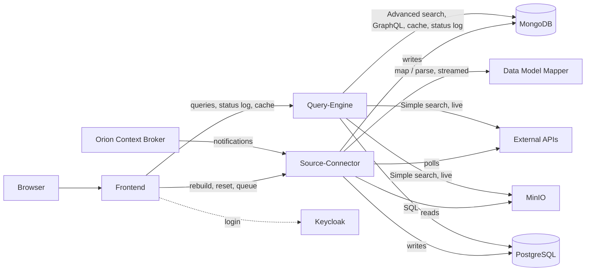

# Architecture

## Who writes, who reads

The **Source-Connector** is the only writer of the collected data. One MongoDB collection and one PostgreSQL table per
connector (`collections` in both configurations, the names must be the same):

| Connector | MongoDB collection (default) | PostgreSQL | Filled by |
|---|---|---|---|
| `api` | `sources` | `sources` | the polls of `apiConnectorConfig.apiUrls` |
| `orion` | `datapoints` | not written by default (`toPostgres: false`) | Orion notifications, mapped by the Data Model Mapper |
| `minio` | `minio` | one table per bucket | the MinIO files (JSON, CSV, GeoJSON) |

Besides the data it writes: the keys / values / entries used for the suggestions, the status of the API polls, the
status log (`statuslog`) and the log of the incremental resets (`incrementalresetlog`).

The **Query-Engine** reads them. It also owns two collections: the GraphQL cache (`queriesmap` and `querycache`, see
[Query cache](cache.html)) and the urls ignored by the status log (`statuslogignored`).

The **Frontend** talks to the Query-Engine for everything users do, and directly to the Source-Connector only for its
management page (rebuild, reset of the incremental APIs, Orion queue).

## Alternative flows at a glance

| Situation | Where it is described |
|---|---|
| The token is missing, invalid or expired, or the user lacks a permission | [Authentication](authentication.html) |
| Authentication disabled on a backend (`disableAuth`) | [Authentication](authentication.html#backends-with-authentication-disabled) |
| The frontend opened without logging in | [Frontend](frontend.html#login-modes) |
| A cached result is incomplete, or the Query-Engine stopped while writing it | [Query cache](cache.html#failures-and-recovery) |
| Many Orion notifications at once, or the Source-Connector restarted with notifications waiting | [Orion notifications](orion-notifications.html) |
| The Data Model Mapper is restarted, stuck, or refuses the token during a mapping | [Orion notifications](orion-notifications.html#when-something-goes-wrong) |
| An API poll interrupted halfway | [Incremental APIs](incremental-apis.html#interrupted-polls) |
| Duplicated records in an incremental API | [Incremental APIs](incremental-apis.html#reset) |
