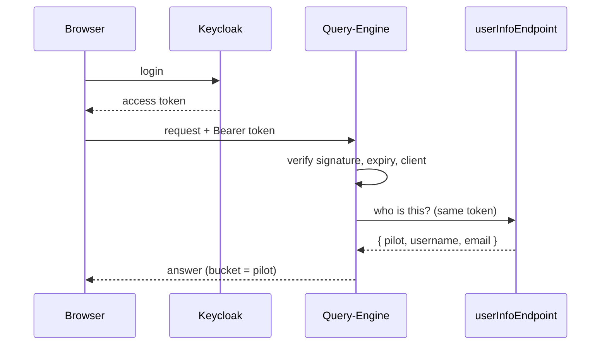

# Authentication

Users log in with Keycloak (OIDC). The frontend sends the access token (`Authorization: Bearer <JWT>`) to the
Query-Engine and to the Source-Connector, which verify it with the realm public key (`authConfig.publicKey`), or with
Keycloak introspection (`authConfig.introspect`). The token must have been issued for `authConfig.clientId`.

## Error codes

All three backends (Query-Engine, Source-Connector, Data Model Mapper) follow RFC 6750:

| Case | Status |
|---|---|
| no token | **401** `WWW-Authenticate: Bearer` |
| malformed token, wrong signature, expired, not yet valid, not active, issued for another client | **401** `WWW-Authenticate: Bearer error="invalid_token", error_description="…"` |
| valid token, but no permission (bucket, prefix, role, management password) | **403** |

A 401 means "get a new token and retry"; a 403 means a new token would not help. The Source-Connector, as a client
of the mapper, still treats a 403 like a 401 (refresh and retry), for mappers older than this change.

## User, bucket and prefix

After verifying the token, the backends ask `authConfig.userInfoEndpoint` (with the same token) for
`{ pilot, username, email }`: the MinIO bucket is `pilot`, the prefix `<email>/<defaultInputFolderName>`. These are used
by the private queries; the frontend does not need them.

| If the user-info call fails | |
|---|---|
| Query-Engine | bucket `minioConfig.defaultBucket`, prefix = e-mail of the token |
| Data Model Mapper | looks for the bucket holding a folder named after the e-mail (`getUserData`); with `minioWriter.restrictAccess` and none found: 500 |

## Who may do what

| Level | Meaning |
|---|---|
| anyone | no token needed: `GET /api/statuslog` (credentials masked) |
| logged user | any valid token |
| administrator | a valid token with one of `authConfig.adminRoles` (Keycloak realm roles or roles of `clientId`); `adminRoles` empty: any logged user |
| + management password | additionally `X-Management-Secret` |

| Operation | Level |
|---|---|
| queries, suggestions, GraphQL | logged user |
| status log, unmasked | administrator |
| ignore / list again a url in the status log | administrator |
| list cache, back up, make a version or a backup active | logged user |
| deactivate the active cache | administrator |
| delete a cache backup | logged user + management password |
| rebuild, Orion queue | logged user |
| reset incremental APIs | logged user + management password (not for the dry run) |

## Management password

The destructive operations (deleting cache backups, resetting incremental APIs) require, besides the login, a password
set in `managementSecret` of **both** configurations (the same value). The frontend asks for it and sends it in the
`X-Management-Secret` header.

- Empty or missing in the configuration: those operations are disabled (403).
- It travels like the token: protected by HTTPS.
- The backends compare SHA-256 digests in constant time (`timingSafeEqual`), so the comparison takes the same time
  whatever the input. Any length works; prefer ASCII characters.

## Backends with authentication disabled

`authConfig.disableAuth: true` (Query-Engine or Source-Connector) skips the token check: every request is accepted,
with the default bucket and folder. Then:

| | |
|---|---|
| GraphQL, queries, suggestions | open |
| status log | open, always masked (there is no administrator) |
| cache management and status-log ignore list (Query-Engine) | **closed** unless `authConfig.adminToken` is set and sent in `X-Admin-Token`; deleting a backup also needs `X-Management-Secret` |
| Source-Connector endpoints | open; the reset still needs the management password |

`adminToken` and `managementSecret` are two separate passwords: they can have the same value if you prefer.

The Data Model Mapper with `disableAuth` uses the `shared` bucket.

## Frontend

The frontend has its own setting, independent of the backends: `enableAuthentication` and `authNotRequired` in its
`config.json`. See [Frontend — login modes](frontend.html#login-modes).
