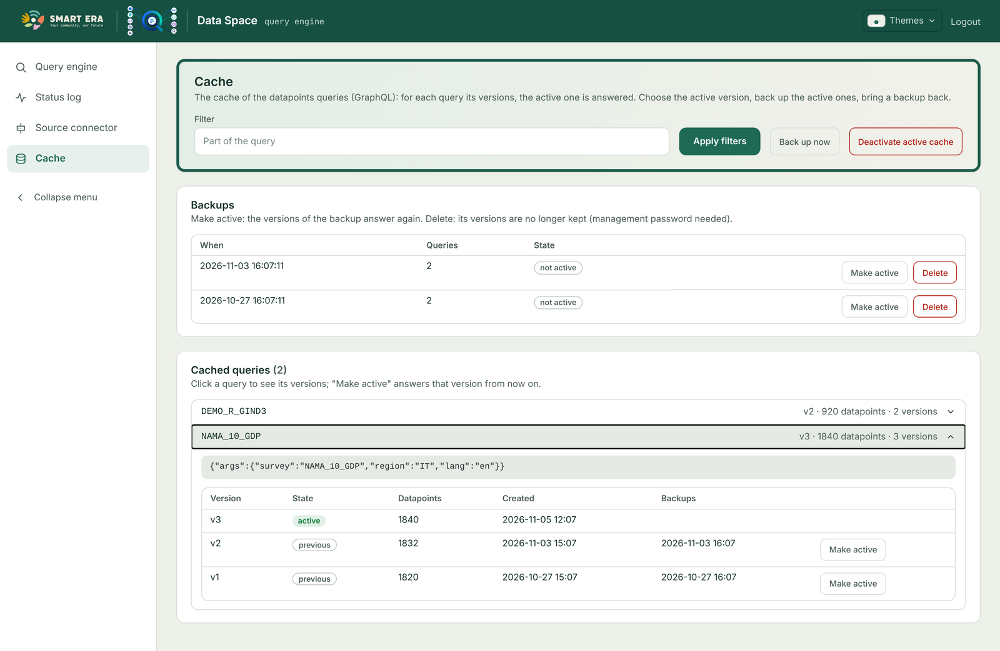
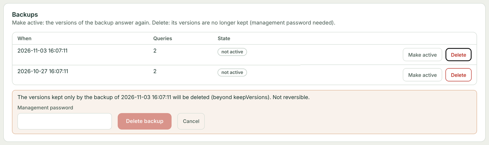
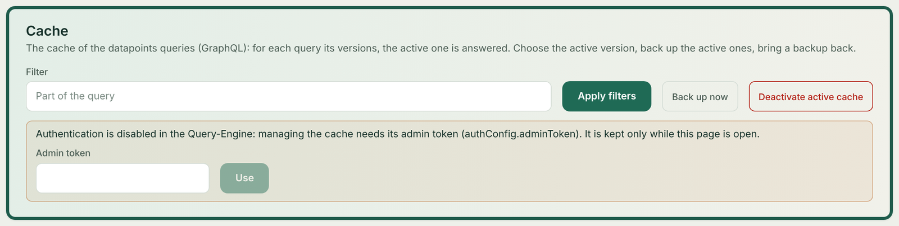

# Query cache

The `datapoints` GraphQL query can be slow (large surveys, translations), so the Query-Engine caches its results. The
cache has three separate mechanisms that are easy to confuse:

| | What it is | What it changes |
|---|---|---|
| **Version** | One stored result of a query: v1, v2, v3… Exactly one is *active* (the one answered). | Created by the queries; deleted only by the automatic pruning. |
| **Backup** | A *label* (a timestamp) put on the versions that were active at that moment. Not a copy, not a version. | Protects the labelled versions from the pruning; lets you make them active again. |
| **Deactivation** | The active versions become *previous*. | Nothing is deleted: the next query computes a new version. |

> **A backup is not a version.** Deleting a backup never empties or deletes a version by itself: it removes the label,
> and only the versions that are then beyond `keepVersions` (and have no other backup) are deleted by the pruning.
> The active version is never deleted.

## Versions

Each `datapoints` query is identified by its arguments (`survey`, `region`, `lang`, `limit`…, stringified: the
*query* shown by the cache page). For each query the `queriesmap` collection holds one row per version:

| State | Meaning |
|---|---|
| `building` | being written; never read |
| `active` | the version answered (at most one per query) |
| `previous` | an older version, kept as history; can be made active again |
| `deleting` | being deleted (its datapoints first, then the row) |

The datapoints of every version are in the `querycache` collection.

When a query has no active version, the Query-Engine computes the result, answers it, and writes it as a **new
version** (the highest existing number + 1): first in full as `building`, then it becomes `active` and the
former active one becomes `previous`. If writing fails, the active version is untouched. A result larger than
`cache.maxDatapoints` (all versions of all queries together) is answered but not cached.

### Pruning (`keepVersions`)

Per query, `cache.keepVersions` versions are kept (default **3**, the active one included). Older `previous`
versions are deleted in background, **unless they have at least one backup label**. There is no endpoint that deletes
a given version: versions go away only through pruning.

Example with `keepVersions: 3` and no backups:

| Event | Versions after it |
|---|---|
| first query | **v1** |
| deactivate, query | v1, **v2** |
| deactivate, query | v1, v2, **v3** |
| deactivate, query | v2, v3, **v4** — v1 is beyond 3 and has no backup: deleted |

Bold: active. After a deactivation, until the next query, no version is active and the 3 newest `previous` ones are
kept.

## Backups

**Back up now** (`GET /api/backupCache`) adds the current timestamp to the `backups` list of every *active* version
(or only of the queries matching the filter). Nothing is copied: the versions are the same rows, now labelled.

- One backup covers all the queries that had an active version at that moment ("Queries" column of the page).
- The same version can carry several labels (backed up twice without changing).
- A labelled version stays even beyond `keepVersions`, until all its labels are removed.

**Make active** on a backup (`GET /api/restoreCache?timestamp=<ts>`) makes the versions with that label active
again, each for its own query. Queries that were not in the backup keep their active version.

**Delete** a backup (`POST /api/resetBackup?timestamp=<ts>`, needs the [management password](authentication.html#management-password))
removes that label from its versions. Then the pruning runs on those queries: a version with no labels left and
beyond `keepVersions` is deleted; a version still within `keepVersions` stays, as an ordinary previous version.

Example, `keepVersions: 3`: v1 was backed up (label B1), then four more versions were computed.

| | Versions | Kept because |
|---|---|---|
| before | v1 (B1), v3, v4, **v5** | v3–v5: the newest 3; v1: label B1 (v2 was pruned) |
| delete B1 | v3, v4, **v5** | v1 has no label left and is beyond 3: deleted |

Had v1 been within the newest three, deleting B1 would have changed nothing visible.

`POST /api/resetBackup` without `timestamp` removes **every** label (of the queries matching the filter).

## Choosing the active version

| Action | Endpoint | Effect |
|---|---|---|
| **Make active** on a version | `GET /api/restoreCache?id=<version id>` | that version becomes active for its query |
| previous version of every query | `GET /api/restoreCache?version=previous` | per query, the newest version older than the active one |
| **Make active** on a backup | `GET /api/restoreCache?timestamp=<ts>` | the versions of that backup |
| **Deactivate active cache** | `POST /api/minio/resetCache` | every active version becomes previous |

The answer of `restoreCache` is `{ restored, alreadyActive }`. Switching is instant and deletes nothing: the version
that was active becomes `previous` and can be brought back the same way.

**Deactivate** is the way to force fresh data: the next `datapoints` query recomputes and stores a new version. It
deletes nothing directly, but the pruning then applies as usual (see the example above).

All the management endpoints accept `queriesMapFilter` / `cacheFilter`: strings that must all appear in the query
(case insensitive), to act on some queries only. `GET /api/listCache` lists the versions (no datapoints) with their
state, count, dates and backups.

## Who can do what

| Action | Authentication on | Authentication disabled (`disableAuth`) |
|---|---|---|
| list, back up, make active | any logged user | `X-Admin-Token` header = `authConfig.adminToken` |
| delete a backup | any logged user + `X-Management-Secret` | `X-Admin-Token` + `X-Management-Secret` |
| deactivate | a user with one of `authConfig.adminRoles` (any logged user if empty) | `X-Admin-Token` |

With authentication disabled and no `adminToken` configured, the cache management is closed (403). The frontend shows
the Cache page only to logged users; when the Query-Engine answers "X-Admin-Token missing or wrong" it asks for the
token and keeps it only while the page is open.

## Failures and recovery

| Situation | What happens |
|---|---|
| The active version has fewer (or more) datapoints than it should (database damaged, datapoints lost) | it is ignored (log: `… datapoints instead of …, ignored`), the result is recomputed and stored as a new version; the damaged one becomes previous and is pruned like any other |
| A backup points to a damaged version and is made active | the same check applies at the next query: the damaged version is never answered |
| The Query-Engine stopped while writing a version | at startup the `building` versions become `deleting` and are removed |
| Two requests compute the same query at the same time | only one writes the version; the other answers its result without caching it |
| The cache cannot be written (e.g. `maxDatapoints` reached) | the query is answered anyway |

## Upgrading

The cache of older versions (one collection per query, rows without state) is ignored by this one. To keep it, import
it with `scripts/migrateCache.js`.
