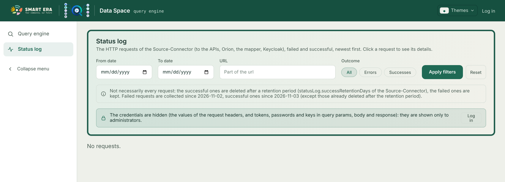
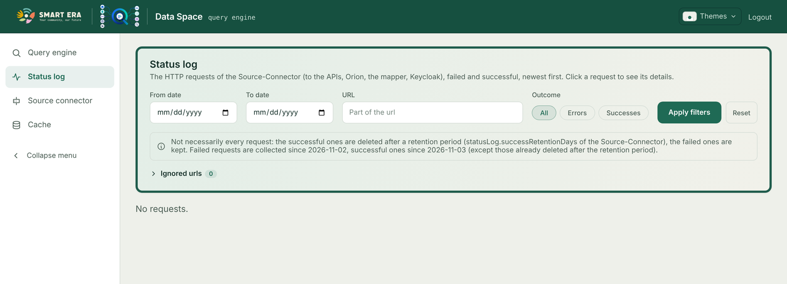

# Frontend

The Angular app of the Data Space. It reads its settings from `assets/config.json` at startup (template:
`frontend/config.template.json`); development notes are in `frontend/local.md`.

## Pages

| Page | Route | Shown to | Purpose |
|---|---|---|---|
| Query engine | `/` | everyone who can open the app | Simple search, Advanced search, SQL, GraphQL |
| Status log | `/status-log` | everyone (credentials hidden from non-administrators) | [Status log](status-log.html) |
| Source connector | `/source-connector` | logged users | rebuild, [reset of incremental APIs](incremental-apis.html#reset), [Orion queue](orion-notifications.html#the-queue) |
| Cache | `/cache` | logged users | [versions, backups, deactivation](cache.html) |

Source connector and Cache are hidden from the menu when nobody is logged in, and their routes are guarded.

**Links to a search.** `/?key=source&value=<url-encoded value>` opens the Advanced search with that filter filled in
(repeat `key` / `value` for more filters). The search starts when the user presses *Apply query*.

**Ready searches.** `presetSearches` in `config.json` adds buttons that fill the Advanced search filters:

```json
"presetSearches": [
  { "label": "Regrowth observations", "filters": [ { "key": "source", "value": "https://api.regrowth.example/observations" } ] }
]
```

## Login modes

| `config.json` | Mode | Behaviour |
|---|---|---|
| `"enableAuthentication": false` | disabled | no login at all, no Login / Logout links; Source connector and Cache are not available |
| `"enableAuthentication": true` | required | the login is needed to open the app; Logout in the bar |
| `"enableAuthentication": true, "authNotRequired": true` | optional | the app opens without logging in, the bar shows **Log in**; after logging in, the pages for logged users appear |





These settings change only the frontend. What a backend answers without a token is decided by its own configuration
(see [Authentication](authentication.html#backends-with-authentication-disabled)). For example, with the frontend in
*optional* mode and the Query-Engine requiring a token, a user who did not log in gets 401 from the queries.

**The current user.** By default the frontend asks `{beopenApiBaseUrl}/api/user` (the dashboard it used to live in),
and shows "Could not load the current user" when that fails. A standalone frontend sets `"userFromToken": true`: the
user (e-mail, name) is read from the claims of the access token, with no request.

## `config.json` reference

| Key | Meaning |
|---|---|
| `queryEngineBaseUrl` | base url of the Query-Engine |
| `graphqlUrl` | GraphQL endpoint, when it is not `{queryEngineBaseUrl}/graphql` (e.g. behind a proxy) |
| `sourceConnectorBaseUrl` | base url of the Source-Connector (Source connector page) |
| `beopenApiBaseUrl` | base url of `/api/user`; also used for the Query-Engine when `queryEngineBaseUrl` is missing |
| `dashboardBaseURL` | public url of the frontend: Keycloak redirects back to `{dashboardBaseURL}/keycloak-auth/callback` |
| `enableAuthentication`, `authNotRequired` | login modes, above |
| `userFromToken` | read the user from the token instead of `/api/user` |
| `keycloak.baseURL`, `keycloak.authProfile` | OIDC endpoint of the realm, profile (`oidc`) |
| `defaultTheme` | `light`, `dark` or `system`, until the user chooses |
| `fontScale` | text size factor (e.g. `1.5`) |
| `collectionLabels` | names shown for the collections, e.g. `{ "api": "Sources", "orion": "Datapoints", "minio": "MinIO" }` |
| `advancedSearchPageSize`, `suggestionsPageSize` | page sizes; never above the limits the Query-Engine announces |
| `presetSearches` | ready Advanced searches, above |
| `statusLogSince` | `{ "errors": "YYYY-MM-DD", "successes": "YYYY-MM-DD" }`: since when each kind of request is collected, shown on the Status log page |

## Credentials typed in the pages

| Field | Page | Kept |
|---|---|---|
| Management password | Source connector (reset), Cache (delete backup) | in the form only, sent with the request |
| Admin token | Cache, when the Query-Engine has authentication disabled | in memory while the Cache page is open; cleared on leaving it |

Neither is stored in the browser.
