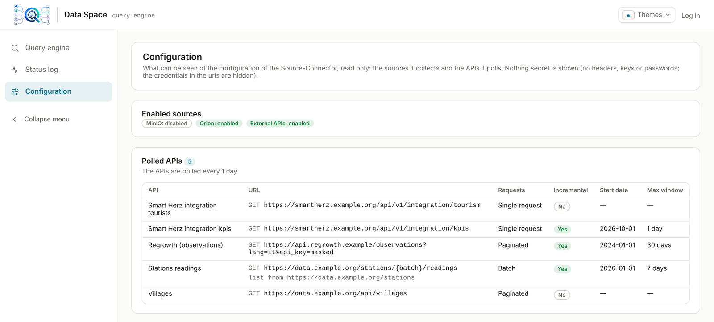
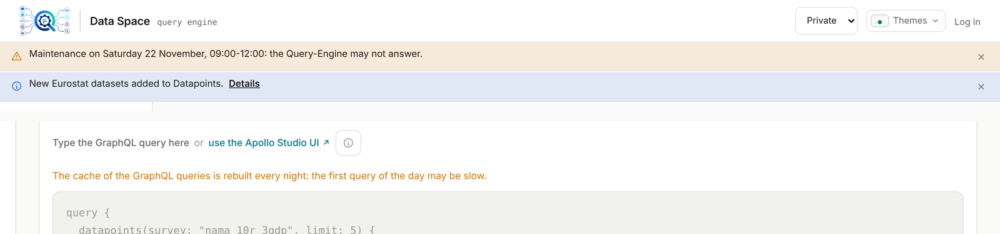
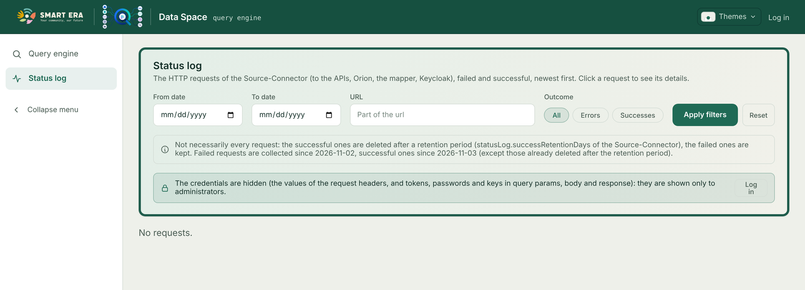
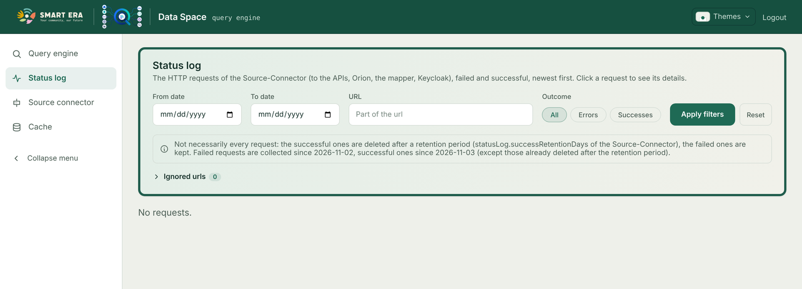

# Frontend

The Angular app of the Data Space. It reads its settings from `assets/config.json` at startup (template:
`frontend/config.template.json`); development notes are in `frontend/local.md`.

## Pages

| Page | Route | Shown to | Purpose |
|---|---|---|---|
| Query engine | `/` | everyone who can open the app | Simple search, Advanced search, SQL, GraphQL |
| Status log | `/status-log` | everyone (credentials hidden from non-administrators) | [Status log](status-log.html) |
| Configuration | `/configuration` | everyone | what can be seen of the Source-Connector configuration, read only (below) |
| Source connector | `/source-connector` | logged users | rebuild, [reset of the APIs](incremental-apis.html#reset) (incremental or not), [backups of the API data](source-connector.html#backups-of-the-api-data), [Orion queue](orion-notifications.html#the-queue) |
| Cache | `/cache` | logged users | [versions, backups, deactivation](cache.html) |

Source connector and Cache are hidden from the menu when nobody is logged in, and their routes are guarded.

**Configuration.** The sources enabled (MinIO, Orion, external APIs), how often the APIs are polled, and every API:
url, method, how it is read (single request, paginated, batch), incremental or not and, if it is, the start date
(`startDateValue`) and the longest window of one request (`maxWindow`; "not applied" without an end date param). It
comes from `GET /api/config` of the Source-Connector, which shows nothing secret: no headers, keys, tokens or bodies;
user and password dropped from the urls and the values of the credential-like query params hidden.



**Links to a search.** `/?key=source&value=<url-encoded value>` opens the Advanced search with that filter filled in
(repeat `key` / `value` for more filters). The search starts when the user presses *Apply query*.

**Notices for the visitors.** `notices` in `config.json`, read when the page is opened (no rebuild):

```json
"notices": {
  "global": [
    { "level": "warning", "text": { "it": "Manutenzione sabato 9-12", "en": "Maintenance on Saturday 9-12" }, "to": "2026-11-22" },
    { "level": "info", "text": "New Eurostat datasets", "link": { "url": "https://example.org/news", "text": "Details" } }
  ],
  "simpleSearch": [], "advancedSearch": [], "sqlQuery": [],
  "graphqlQuery": ["The first GraphQL query of the day may be slow."]
}
```

| Section | Where |
|---|---|
| `global` | a bar under the header, on every page, only when a notice is shown; the visitor can close one (it stays closed in that browser until its text changes) |
| `simpleSearch`, `advancedSearch`, `sqlQuery`, `graphqlQuery` | in the query card, in yellow, after the notices the mode already shows (e.g. the sources not stored in MongoDB); empty: only those |

A notice is a text, or `{ text, level?, from?, to?, link? }`: `text` a string or `{ "en": "…", "it": "…" }` (the
language of the site, else English); `level` `"info"` (blue) or `"warning"` (yellow, default; the global bar only);
`from` / `to` the period it is shown in (`YYYY-MM-DD` or a date and time; a date alone as `to` includes that day);
`link` an http(s) url or `{ url, text }`.



**Ready searches.** `presetSearches` in `config.json` adds buttons that fill the Advanced search filters:

```json
"presetSearches": [
  { "label": "Regrowth observations", "filters": [ { "key": "source", "value": "https://api.regrowth.example/observations" } ] },
  { "label": "Created in January, with a city", "filters": [
    { "key": "created", "from": "2026-01-01", "to": "2026-02-01" },
    { "key": "city", "exists": true }
  ] }
]
```

A filter is one of the value types of the Advanced search: `{ key, value }` a value (String); `{ key, from, to }` a date
range (Date: from included, to excluded, one bound is enough; `YYYY-MM-DD` or a date and time; UTC unless
`"utc": false`, the time zone of the browser); `{ key, "exists": true }` the field is there, any value (Exists). The
tooltip of a button shows its full name, then one line per filter.

## Login modes

| `config.json` | Mode | Behaviour |
|---|---|---|
| `"enableAuthentication": false` | disabled | no login at all, no Login / Logout links; Source connector and Cache are not available |
| `"enableAuthentication": true` | required | the login is needed to open the app; Logout in the bar |
| `"enableAuthentication": true, "authNotRequired": true` | optional | the app opens without logging in, the bar shows **Log in**; after logging in, the pages for logged users appear |





These settings change only the frontend. What a backend answers without a token is decided by its own configuration
(see [Authentication](authentication.html#backends-with-authentication-disabled)). For example, with the frontend in
*optional* mode and the Query-Engine requiring a token, a user who did not log in gets 401 from the queries.

**The current user.** By default the frontend asks `{beopenApiBaseUrl}/api/user` (the dashboard it used to live in),
and shows "Could not load the current user" when that fails. A standalone frontend sets `"userFromToken": true`: the
user (e-mail, name) is read from the claims of the access token, with no request.

**The login.** Authorization code flow with PKCE (`angular-auth-oidc-client`), the client id of
`environment.keycloak.client_id`. In Keycloak the client is public, with valid redirect URI
`{dashboardBaseURL}/keycloak-auth/callback`, valid post logout redirect URI `{dashboardBaseURL}` (or `+`) and web origin
the url of the frontend: the browser itself asks Keycloak for the tokens. The tokens are kept in `localStorage` (shared
by the tabs) and the access token is renewed with the refresh token while the app is open; when the Keycloak session
ends, the next page that needs the login goes back to Keycloak. Logout ends the Keycloak session as well.

## `config.json` reference

| Key | Meaning |
|---|---|
| `queryEngineBaseUrl` | base url of the Query-Engine |
| `graphqlUrl` | GraphQL endpoint, when it is not `{queryEngineBaseUrl}/graphql` (e.g. behind a proxy) |
| `sourceConnectorBaseUrl` | base url of the Source-Connector (Source connector page) |
| `beopenApiBaseUrl` | base url of `/api/user`; also used for the Query-Engine when `queryEngineBaseUrl` is missing |
| `dashboardBaseURL` | public url of the frontend: Keycloak redirects back to `{dashboardBaseURL}/keycloak-auth/callback` |
| `enableAuthentication`, `authNotRequired` | login modes, above |
| `userFromToken` | read the user from the token instead of `/api/user` |
| `keycloak.baseURL` | OIDC endpoint of the realm: `https://<host>/auth/realms/<realm>/protocol/openid-connect` (`/auth` only if your Keycloak has that path) |
| `keycloak.issuer` | only when the tokens carry another issuer than the realm url of `baseURL` (Keycloak reached through another host name) |
| `defaultTheme` | `light`, `dark` or `system`, until the user chooses |
| `fontScale` | text size factor (e.g. `1.5`) |
| `collectionLabels` | names shown for the collections, e.g. `{ "api": "Sources", "orion": "Datapoints", "minio": "MinIO" }` |
| `advancedSearchPageSize`, `suggestionsPageSize` | page sizes; never above the limits the Query-Engine announces |
| `presetSearches` | ready Advanced searches, above |
| `statusLogSince` | `{ "errors": "YYYY-MM-DD", "successes": "YYYY-MM-DD" }`: since when each kind of request is collected, shown on the Status log page |

## Credentials typed in the pages

| Field | Page | Kept |
|---|---|---|
| Management password | Source connector (reset), Cache (delete backup) | in the form only, sent with the request |
| Admin token | Cache, when the Query-Engine has authentication disabled | in memory while the Cache page is open; cleared on leaving it |

Neither is stored in the browser.
