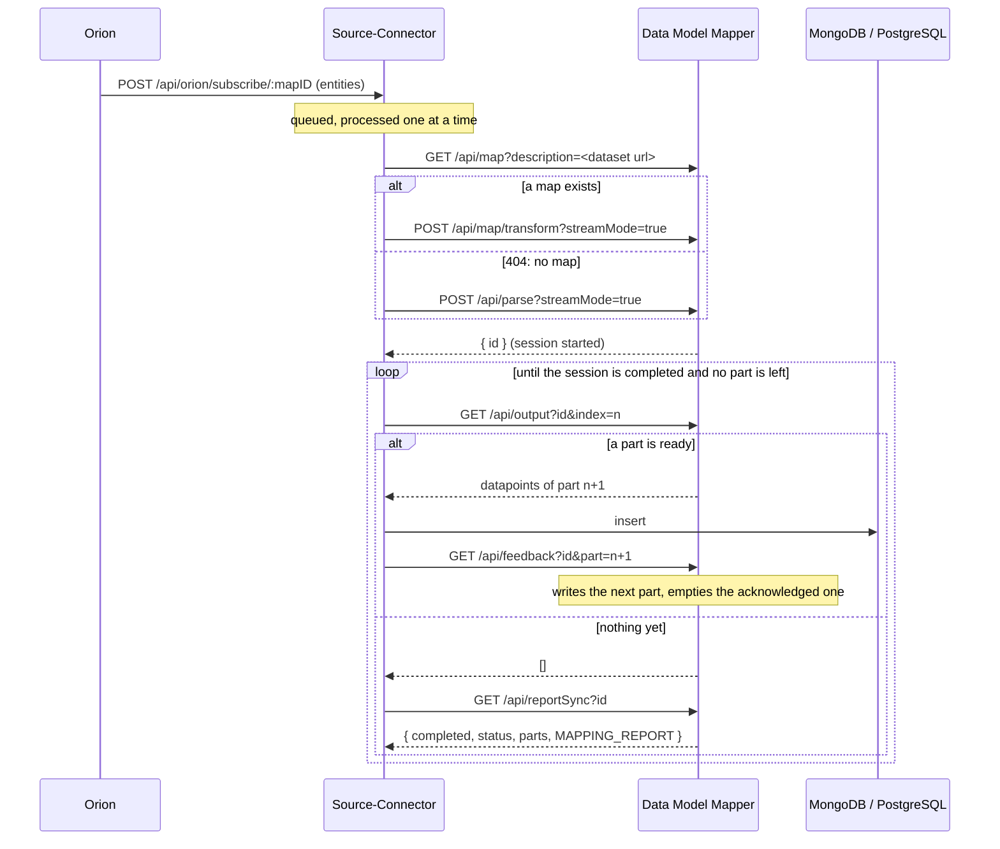

# Orion notifications

Orion holds `DistributionDCAT-AP` entities: each one describes a dataset and points to its download url. When an
entity changes, Orion notifies the Source-Connector, which downloads the dataset (through the Data Model Mapper) and
replaces its datapoints in the `orion` collection.

## Flow of one notification



1. **mapID.** Taken from the url (`/api/orion/subscribe/<mapID>`, or `?mapID=`), from the entity, or from `mapID` in
   the configuration. Without a mapID the dataset is downloaded and stored as it is, without the mapper.
2. **Map or parse.** The Source-Connector asks the mapper for a map of the dataset url. Only a 404 ("no map") means
   *parse instead*; any other error (token refused, mapper down) is an error of this attempt.
3. **Streamed session.** The request carries `streamMode=true`, `waitForFeedback: true` and `deleteAckedParts: true`:
   the mapper answers at once with a session id and writes the result in parts. It writes a part, then **waits for
   the feedback** before the next one, so parts never pile up faster than they are stored.
4. **Reading.** The Source-Connector reads part after part. A part is read whole until it is acknowledged and never
   read again after: an empty answer means "not written yet" or "no more parts", and `GET /api/reportSync` tells them
   apart. The session ends when the mapper says `completed` and one more look finds nothing.
5. **Storing.** At the first non-empty part the datapoints of that dataset are replaced (or upserted by `dupl_hash` with
   `upsertRecords`), so a dataset mapped twice is never stored twice.

Details on the mapper side: `backend/docs/streaming-sessions.md` in the Data Model Mapper repository. The mapper must
store its parts somewhere (`sessionLocation.filesystem` or `sessionLocation.mongo` true), otherwise every read is empty
and the session ends with no datapoints.

## The queue

Notifications are processed **one at a time, in arrival order**, whoever sends them (Orion, or the recovery check
below). An error ends that notification only: the next ones go on. This keeps two mappings of the same dataset from
running in parallel and inserting the same rows twice, and keeps the mapper from being flooded.

`GET /api/queue` shows it:

```json
{
  "queue": 3,
  "processing": { "receivedAt": "...", "startedAt": "...", "entities": [ { "id": "...", "url": "https://..." } ] },
  "waiting": [ { "receivedAt": "...", "entities": [ { "id": "...", "url": "https://..." } ] } ]
}
```

At most 20 entities are listed per notification (`moreEntities` counts the rest). The Source connector page of the
frontend shows the same, refreshing every 3 seconds while the queue is not empty.

**Limits.**

- The queue lives in memory. A restart of the Source-Connector loses the notifications still waiting; the recovery
  check at startup finds those datasets again (their entities differ from the stored ones).
- One Source-Connector instance only: two instances would each have their own queue.

## Recovery check (lost notifications)

`verifyLostSubscriptionOrion` reads every entity from Orion (or from `ngsiBrokerUrl` with `useNgsiBroker`), compares
it with the stored copy, and sends a notification to itself for each entity that changed. It runs:

- at startup, if `orion.subscribe` is true;
- every `orion.checkSubscriptionInterval` ms, if set;
- on `PUT /api/query`.

Its notifications go through the same queue. With a very short interval the same dataset can be queued more than once
before the first run has finished: the runs are executed one after the other and each replaces the datapoints of the
dataset, so the data is not duplicated, only the work repeated.

New entities whose attributes match `orion.skippingParams` are not synchronised; entities already stored keep being
updated.

## When something goes wrong

| Situation | What happens |
|---|---|
| The mapper refuses the token (401, or 403 from older mappers) during a read | the token is refreshed once and the read repeated |
| The token is refused when the session is started | the token is refreshed and the whole notification retried once |
| A connection reset by the mapper during a read or a feedback | the request is repeated at once (twice at most) |
| The feedback fails | retried 5 times with growing pauses, then the notification fails |
| The mapper does not know the session or does not answer (restarted, session expired) | given up after `dmmSessionLostTimeoutMs` (default 5 min) |
| The session is alive but nothing moves | given up after `dmmNoProgressTimeoutMs` (default 30 min) |
| The session ends with an error | the notification fails with the mapper's error |
| The Source-Connector stops reading | the mapper gives up after `streamFeedbackTimeoutMs` (default 30 min) |

Every one of these requests is in the [status log](status-log.html).

## Known limitation

The notifications sent by Orion, and those the recovery check sends to itself, carry no token. With authentication
enabled on the Source-Connector (`authConfig.disableAuth: false`) `POST /api/orion/subscribe/:mapID` answers 401 to
them. The recovery check also posts to a fixed mapID (`6914a252ddb96948ee67b2e1`) instead of `config.mapID`.
