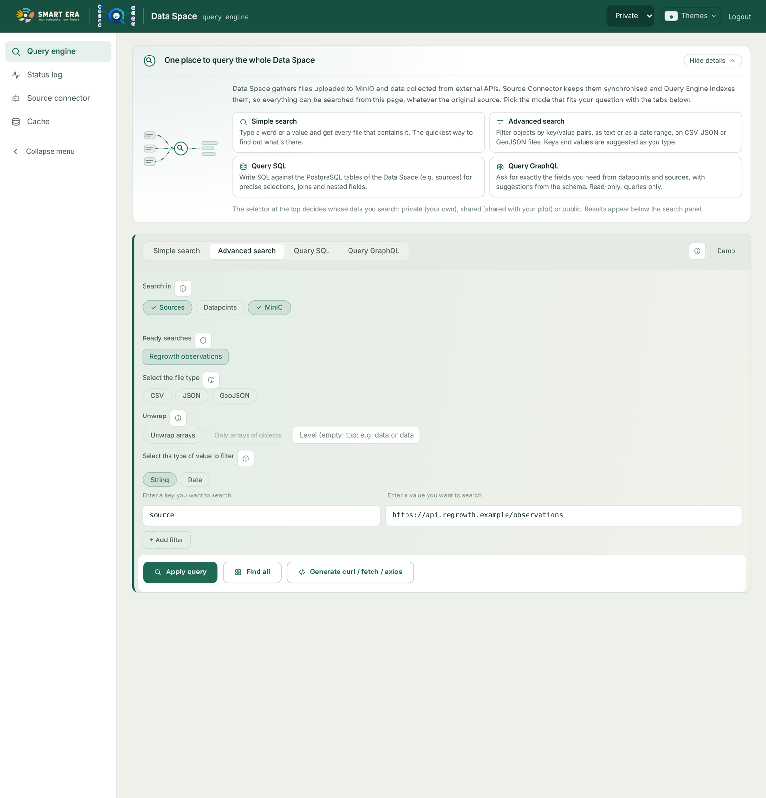

# Query Engine

The Query-Engine answers the queries of the frontend (and of any other client) over the data collected by the
Source-Connector. Every endpoint is under `/api` (`basePath` in the configuration), GraphQL under `/graphql`.

## Kinds of query

| Kind | Searches | Request |
|---|---|---|
| **Simple search** | A word or value anywhere: MinIO files, and live the APIs of `apiConnectorConfig.apiUrls` and (if enabled) Orion, as `simpleSearchOptions` says | `GET /api/query?value=…` with header `isRawQuery: yes` |
| **Advanced search** | Key / value filters (text or date range) on the MongoDB collections, optionally unwrapping arrays | `POST /api/query?<key>=<value>…` with `{ mongoQuery, page, collections }` in the body |
| **SQL** | The PostgreSQL tables (only the collections with `toPostgres`) | `POST /api/query` with `{ query }` |
| **GraphQL** | The Orion datapoints (`datapoints` query, cached) and the sources | `POST /graphql` |

What is left out of a search (a source disabled by the configuration, an API that did not answer, results cut) is
reported in the `X-Query-Warnings` response header (URI-encoded JSON) and shown by the frontend as a warning.

### Collections

The results can be restricted to some collections: `api`, `orion`, `minio` (`collections` in the body, or
`?collections=api,minio` for the suggestions). `GET /api/collections` tells the frontend which ones exist, which are
searched by default (`queryOptions.defaultCollections`), which are in PostgreSQL, and the highest page sizes accepted.
A request without `collections` (older clients) searches the default ones.

### Limits

| Setting (`queryOptions`) | Meaning |
|---|---|
| `advancedSearchMaxResults` (1000) | highest page size of the Advanced search, and number of results without a page |
| `suggestionsMaxResults` (500) | highest page size of the keys / values / entries suggestions |
| `graphQLDefaultLimit` / `graphQLMaxLimit` | documents returned by GraphQL sources without / with a limit |
| `mongoMaxTimeMS` (900000) | MongoDB stops a query after this time; the request gets 504 |

There is no limit on the total: a client reads every result page by page, see
[Advanced search paging](advanced-search-paging.html).

## Endpoints

| Endpoint | Who | Purpose |
|---|---|---|
| `GET /api/query`, `POST /api/query` | logged user | the queries above |
| `GET /api/query/simple/limits` | logged user | what the Simple search leaves out by configuration |
| `GET /api/collections` | logged user | collections and limits |
| `GET /api/keys`, `/api/values`, `/api/entries`, `/api/keys/notIndexed` | logged user | suggestions, one page at a time (`limit`, `skip` → `{ items, hasMore }`) |
| `POST /graphql` | logged user (open with `disableAuth`) | GraphQL |
| `GET /api/listCache`, `/api/backupCache`, `/api/restoreCache` | logged user | [cache](cache.html) management |
| `POST /api/resetBackup` | logged user + management password | delete a cache backup |
| `POST /api/minio/resetCache` | administrator | deactivate the active cache versions |
| `GET /api/statuslog`, `/api/statuslog/ignored` | anyone (credentials hidden from non-administrators) | [status log](status-log.html) |
| `POST` / `DELETE /api/statuslog/ignored` | administrator | ignore a url or a prefix / list it again |

"Logged user", "administrator" and what changes with authentication disabled are explained in
[Authentication](authentication.html).

## Visibility and bucket

Every query carries a `visibility` header (`private` by default, `shared`, `public`). For private data the
Query-Engine needs the user's bucket and prefix: it asks `authConfig.userInfoEndpoint` with the user's token
(`{ pilot, username, email }` → bucket = `pilot`, prefix = `<email>/<defaultInputFolderName>`). If that endpoint is not
configured or fails, it uses `minioConfig.defaultBucket` and the e-mail of the token as prefix. The frontend never
needs to know the bucket.
