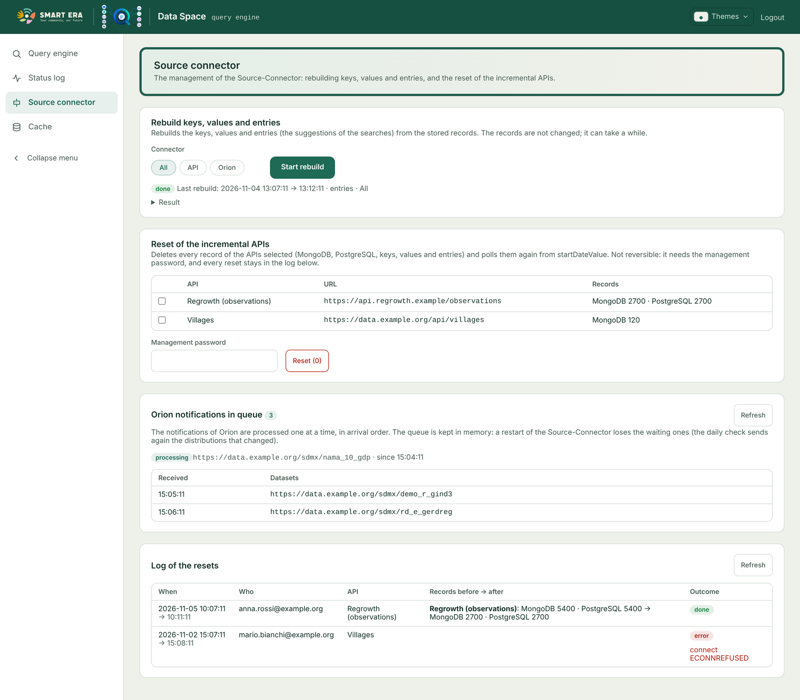
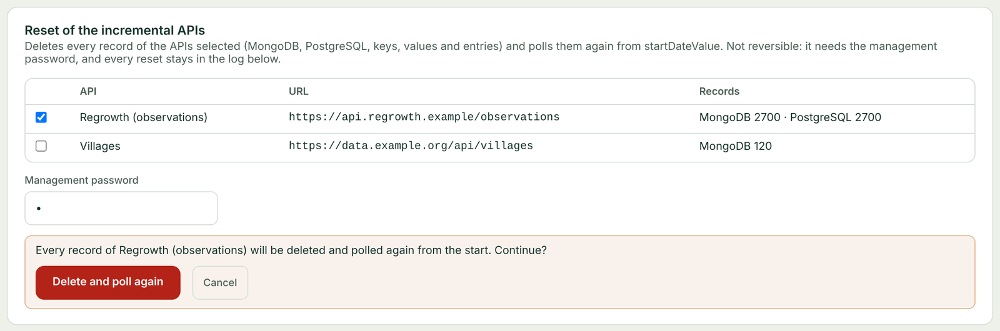
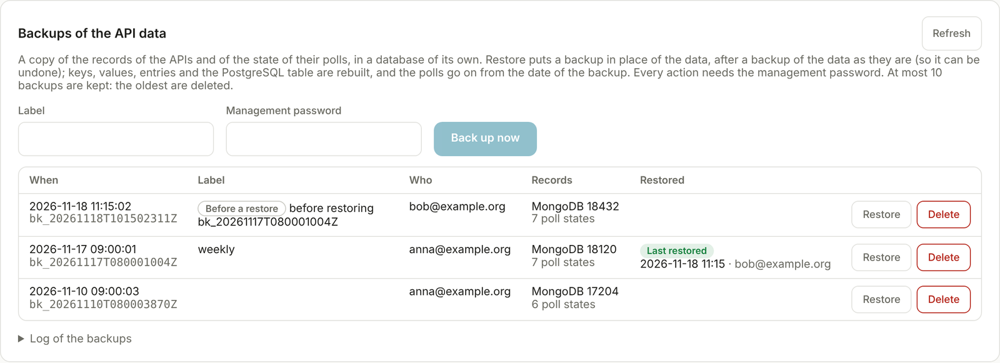

# Source Connector

The Source-Connector collects the data of the Data Space and writes it to MongoDB and PostgreSQL. Every endpoint is
under `/api`.

## Connectors

Enabled in `sourceConnectors` (at least one, or the Query-Engine finds nothing):

| Connector | Source | Details |
|---|---|---|
| `minioConnector` | JSON, CSV and GeoJSON files in MinIO | synchronised at startup (unless `doNotSyncAtStart`), every `syncInterval` and by `PUT /api/query` |
| `orionConnector` | Orion `DistributionDCAT-AP` entities: each one points to a dataset, mapped by the Data Model Mapper | [Orion notifications](orion-notifications.html) |
| `apiConnector` | the APIs of `apiConnectorConfig.apiUrls`, polled every `pollInterval` | [Incremental APIs](incremental-apis.html) |

Where each connector writes is set by `collections` (same values in the Query-Engine config):

```js
collections: {
  api:   { mongo: "sources",    toMongo: true, postgres: "sources",    toPostgres: true },
  orion: { mongo: "datapoints", toMongo: true, postgres: "datapoints", toPostgres: false },
  minio: { mongo: "minio",      toMongo: true, toPostgres: true }   // one PostgreSQL table per bucket
}
```

`queryOptions.advancedSearch: false` stops every MongoDB write, `queryOptions.SQLQuery: false` every PostgreSQL write,
whatever `toMongo` / `toPostgres` say. Moving from the old single `sources` collection: `scripts/migrateCollections.js`.

## Non incremental APIs

An API without `incrementalParams` returns, at every poll, a list that may repeat what was already stored. Each record
stored gets `datePolled`; the answer is compared with the records already stored for its url (by content: every field
except `_id`, `datePolled` and the flags below, whatever the order of the keys):

1. **By order.** The answer is taken as the continuation of the stored records, like a window sliding over the data,
   oldest first: its first record is looked for among the stored ones; from that occurrence to the end, the stored
   records must be the beginning of the answer (and not longer than it). Then only the rest of the answer is stored,
   flagged `likelyIncremental: true`. An occurrence that does not fit: the next one. This also catches a repeated record
   that went out of the window while an identical one came in.
2. **Otherwise** (records shuffled, replaced, or removed here and there), as configured in `unalignedAnswer` on the
   API (or for every API in `apiConnectorConfig`):

| `unalignedAnswer` | What is stored |
|---|---|
| `"upsert"` | the records of the url replaced by the answer |
| `"append"` | the whole answer appended, flagged `unverifiedAppend: true` (maybe duplicates, interval unknown) |
| not set (default) | by count: of each record, only the copies beyond those already stored (3 stored, 4 in the answer: 1) |

With `upsertRecords: true` (on the API, or in `apiConnectorConfig`) none of this applies: every answer replaces the
records of the url, as it always did. The first answer of a url is stored whole, duplicates included. For a paginated API all the pages are read first, then
compared. An answer that begins with the last stored record counts as a continuation even if they have only that
record in common.

## Endpoints

| Endpoint | Purpose |
|---|---|
| `POST /api/orion/subscribe/:mapID`, `POST /api/orion/subscribe` | Orion notification (queued); **open**, no token |
| `GET /api/queue` | the Orion notifications waiting or being processed |
| `GET /api/config` | what can be shown of the configuration (connectors enabled, poll interval, APIs: url, paginated / batch, incremental, start date, maxWindow); **open**, nothing secret |
| `PUT /api/query` | synchronise MinIO and check the Orion entities now |
| `POST /api/rebuild`, `GET /api/rebuild` | rebuild keys / values / entries or PostgreSQL; progress |
| `POST /api/incremental/reset`, `GET /api/incremental/reset` | reset APIs (incremental or not); progress |
| `GET /api/incremental/reset/log` | every reset done |
| `GET /api/backups`, `GET /api/backups/log` | the [backups of the API data](#backups-of-the-api-data), the action running, every action done |
| `POST /api/backups`, `POST /api/backups/:id/restore`, `DELETE /api/backups/:id` | backup, restore, delete (management password) |

All of them except the Orion notifications and `GET /api/config` require a valid token, unless `authConfig.disableAuth` is true (Orion
cannot send one: see [Orion notifications](orion-notifications.html#no-token-on-the-notification-route)). The reset also requires the
[management password](authentication.html#management-password).

## Management page

The frontend page **Source connector** (logged users only) talks to these endpoints directly, using
`sourceConnectorBaseUrl` of its `config.json`.



### Rebuild keys, values and entries

The suggestions of the Advanced search (keys, values, key/value entries) are kept up to date while data is written. If
they drift (old data, a change of `datapointsNotIndexed`, an interrupted write), rebuild them:

```
POST /api/rebuild?mode=entries&connector=orion
```

| Parameter | Values |
|---|---|
| `mode` (required) | `entries`: keys / values / entries from the MongoDB collection; `postgres`: the PostgreSQL table becomes a mirror of the MongoDB collection (only `toPostgres` connectors); `all`: both |
| `connector` | `api` or `orion` (default both). MinIO is rebuilt by its synchronisation, not here |
| `origin` | only the records of this url (requires `connector`) |
| `keepLegacy` | `true`: don't remove the old keys / values / entries without connector |

It runs in background (202); `GET /api/rebuild` gives the state and the result. The records themselves are not
changed. Refused (409) while another rebuild, a reset or an API poll is running.

### Reset of the APIs

Deletes every record of the chosen APIs, incremental or not, and polls them again from the start. See
[Incremental APIs](incremental-apis.html#reset).



### Backups of the API data

A backup copies the records of the APIs (`collections.api`) and the state of their incremental polls
(`incrementalstate`) into a **MongoDB database of their own** (`apiBackup.mongoDb`, default `<main database>_backups`;
MongoDB 4.4 or later, the copy is made by the server). The main database stays clean, and the Query-Engine never sees
the backups: it does not know that database, and nothing is copied into PostgreSQL, where its SQL runs (with the
reader user). The records of an interrupted poll are dropped before copying, as the next poll would do.

**Restore** puts a backup in place of the data, after a backup of the data as they are (kind "before a restore": it
can be undone): the records and the poll states are replaced (indexes kept), the pending poll marks cleared, keys /
values / entries of the API records rebuilt, and the PostgreSQL table rebuilt from MongoDB. The polls go on from the
date of the backup: the incremental APIs ask again what came after it. With the records in PostgreSQL only
(`toMongo: false`), its rows are backed up and restored instead.

| Detail | |
|---|---|
| where | Source connector page, or the endpoints above |
| password | `managementSecret`, in `X-Management-Secret`; not configured: disabled (403) |
| how many | `apiBackup.maxBackups` (default 10, 0: no limit): the oldest beyond it are deleted, never the one being restored |
| refused (409) | while a poll, a rebuild, a reset or another backup action runs |
| progress | backup and restore run in background (202), `GET /api/backups` says the action running or the last one |
| log | every action, in `apibackuplog` of the backup database (`GET /api/backups/log`) |



### Orion notifications in queue

Shows the notification being processed and the waiting ones, refreshing every 3 seconds while the queue is not empty.
See [Orion notifications](orion-notifications.html#the-queue).

## Status log

Every HTTP request of the Source-Connector is recorded: see [Status log](status-log.html).
