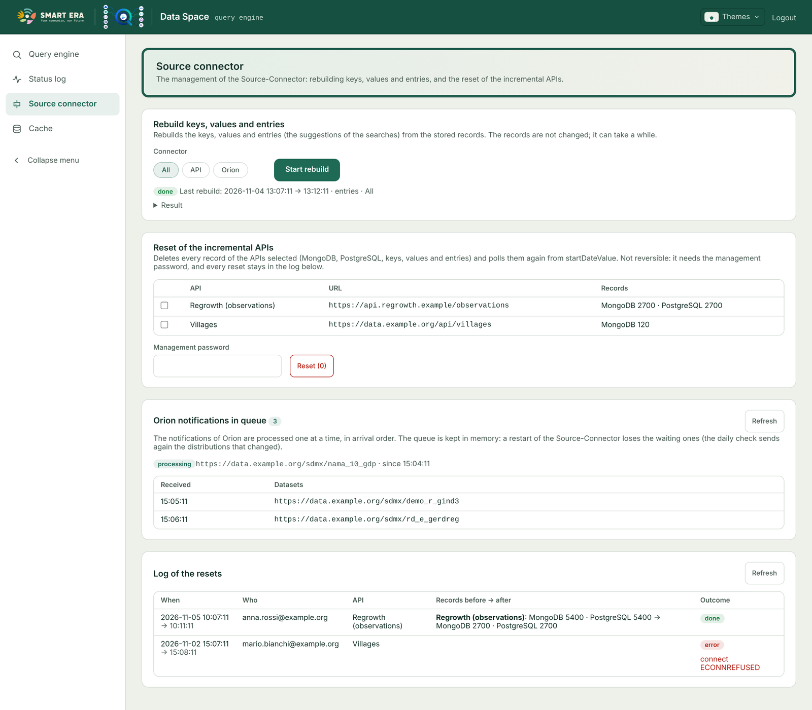
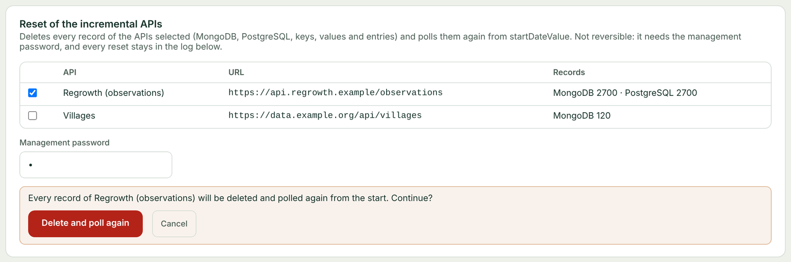

# Source Connector

The Source-Connector collects the data of the Data Space and writes it to MongoDB and PostgreSQL. Every endpoint is
under `/api`.

## Connectors

Enabled in `sourceConnectors` (at least one, or the Query-Engine finds nothing):

| Connector | Source | Details |
|---|---|---|
| `minioConnector` | JSON, CSV and GeoJSON files in MinIO | synchronised at startup (unless `doNotSyncAtStart`), every `syncInterval` and by `PUT /api/query` |
| `orionConnector` | Orion `DistributionDCAT-AP` entities: each one points to a dataset, mapped by the Data Model Mapper | [Orion notifications](orion-notifications.html) |
| `apiConnector` | the APIs of `apiConnectorConfig.apiUrls`, polled every `pollInterval` | [Incremental APIs](incremental-apis.html) |

Where each connector writes is set by `collections` (same values in the Query-Engine config):

```js
collections: {
  api:   { mongo: "sources",    toMongo: true, postgres: "sources",    toPostgres: true },
  orion: { mongo: "datapoints", toMongo: true, postgres: "datapoints", toPostgres: false },
  minio: { mongo: "minio",      toMongo: true, toPostgres: true }   // one PostgreSQL table per bucket
}
```

`queryOptions.advancedSearch: false` stops every MongoDB write, `queryOptions.SQLQuery: false` every PostgreSQL write,
whatever `toMongo` / `toPostgres` say. Moving from the old single `sources` collection: `scripts/migrateCollections.js`.

## Endpoints

| Endpoint | Purpose |
|---|---|
| `POST /api/orion/subscribe/:mapID` | Orion notification (queued) |
| `GET /api/queue` | the Orion notifications waiting or being processed |
| `PUT /api/query` | synchronise MinIO and check the Orion entities now |
| `POST /api/rebuild`, `GET /api/rebuild` | rebuild keys / values / entries or PostgreSQL; progress |
| `POST /api/incremental/reset`, `GET /api/incremental/reset` | reset incremental APIs; progress |
| `GET /api/incremental/reset/log` | every reset done |

All of them require a valid token, unless `authConfig.disableAuth` is true. The reset also requires the
[management password](authentication.html#management-password).

## Management page

The frontend page **Source connector** (logged users only) talks to these endpoints directly, using
`sourceConnectorBaseUrl` of its `config.json`.



### Rebuild keys, values and entries

The suggestions of the Advanced search (keys, values, key/value entries) are kept up to date while data is written. If
they drift (old data, a change of `datapointsNotIndexed`, an interrupted write), rebuild them:

```
POST /api/rebuild?mode=entries&connector=orion
```

| Parameter | Values |
|---|---|
| `mode` (required) | `entries`: keys / values / entries from the MongoDB collection; `postgres`: the PostgreSQL table becomes a mirror of the MongoDB collection (only `toPostgres` connectors); `all`: both |
| `connector` | `api` or `orion` (default both). MinIO is rebuilt by its synchronisation, not here |
| `origin` | only the records of this url (requires `connector`) |
| `keepLegacy` | `true`: don't remove the old keys / values / entries without connector |

It runs in background (202); `GET /api/rebuild` gives the state and the result. The records themselves are not
changed. Refused (409) while another rebuild, a reset or an API poll is running.

### Reset of the incremental APIs

Deletes every record of the chosen incremental APIs and polls them again from the start. See
[Incremental APIs](incremental-apis.html#reset).



### Orion notifications in queue

Shows the notification being processed and the waiting ones, refreshing every 3 seconds while the queue is not empty.
See [Orion notifications](orion-notifications.html#the-queue).

## Status log

Every HTTP request of the Source-Connector is recorded: see [Status log](status-log.html).
