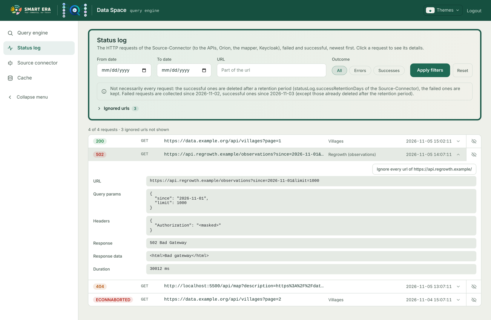
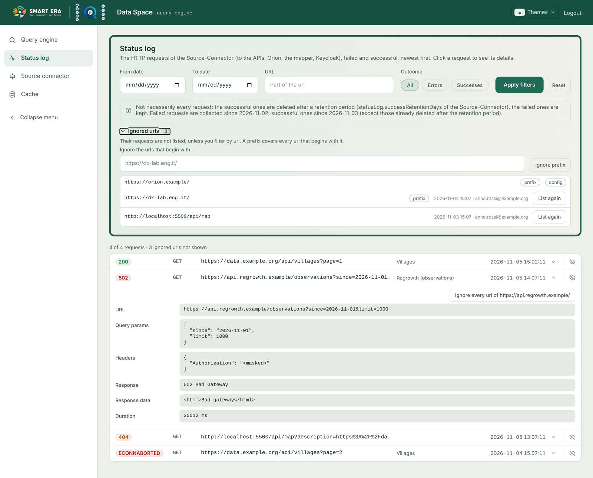

# Status log

The status log lists the HTTP requests made by the Source-Connector (to the APIs, Orion, the Data Model Mapper,
Keycloak…), failed and successful, newest first.



## Recording (Source-Connector)

Every axios request of the Source-Connector is saved in the MongoDB collection `statuslog`: when, outcome (`error` /
`success`), the API it belongs to (matched by url), method, url, query params, headers, body, status, response data or
error, duration (`durationMs`). A request with no answer (timeout, connection refused, DNS) is an error too, and so is
a request the code expects to fail (e.g. "no map yet" from the mapper).

| `statusLog` setting | Default | Meaning |
|---|---|---|
| `enabled` | `true` | record at all |
| `successes` | `true` | record the successful requests too (`false`: errors only) |
| `successRetentionDays` | `30` | successes are deleted after this many days (MongoDB TTL index on `expiresAt`); `0`: never. Errors are never deleted. |
| `maxDataSize` | `10000` | body and response data are cut at this many characters |

Records are stored **as they are, credentials included**: the collection is as private as the database. Hiding
happens only in the answers of the Query-Engine.

With the successes of the Orion and mapper calls also recorded, the collection can grow quickly: lower
`successRetentionDays` if needed.

## Reading (Query-Engine)

`GET /api/statuslog` — filters in the query string:

| Parameter | Meaning |
|---|---|
| `from`, `to` | dates (ISO; a bare `YYYY-MM-DD` as `to` covers that whole day) |
| `url` | part of the url, case insensitive (url and full url with query string) |
| `outcome` | `error` or `success` (records older than the success logging have no outcome: they count as errors) |
| `limit`, `skip` | a page (limit 1–1000); without limit, every matching record |

Answer: `{ items, total, masked, ignoredExcluded }`.

**Masking.** Anyone may read the status log, even without logging in. Unless the caller is an administrator (a token
with one of `authConfig.adminRoles`, or any valid token when `adminRoles` is empty), the credentials are replaced by
`<masked>`: every request header value, and the values of sensitive fields (password, secret, token, api key,
authorization, cookie, session, signature, private key) in query params, url query strings, body and response. The
keys stay visible, so a token request still shows `client_id` and `grant_type`, but not `client_secret` or
`access_token`. With authentication disabled everyone gets the masked view.

## Ignored urls

Requests whose url is uninteresting (a health check, a whole domain) can be hidden from the list.



- **Exact url** or **prefix** (`match: "prefix"`): a prefix covers every url beginning with it, e.g.
  `https://dx-lab.eng.it/` for a whole domain (a prefix ending with `/` also covers the url without it). A prefix must
  contain at least scheme and host, so that it cannot hide everything.
- Compared with the `url` of the record (without the query params the connector added), case sensitive.
- Without a `url` filter the ignored requests are left out (date filters don't bring them back) and
  `ignoredExcluded` says how many ignored urls were applied. With a `url` filter they are listed, marked `ignored`.
- Nothing is deleted: listing a url again shows its past requests too.

| Source | How | Removable from the frontend |
|---|---|---|
| configuration | `statusLog.ignoredUrls` (exact), `statusLog.ignoredPrefixes` in the Query-Engine config | no: edit the config |
| frontend / API | `POST /api/statuslog/ignored { url, match }`, `DELETE /api/statuslog/ignored?url=&match=prefix` (administrators) | yes ("List again") |

`GET /api/statuslog/ignored` lists both, the configured ones first (`fromConfig: true`).

## The note on the page

Not every request ever made is in the list: successes expire after the retention period, and the logging of errors and
of successes may have started on different days. `statusLogSince` in the frontend `config.json` states it:

```json
"statusLogSince": { "errors": "2026-11-02", "successes": "2026-11-03" }
```

The page then says "Failed requests are collected since 2026-11-02, successful ones since 2026-11-03". Dates not in
`YYYY-MM-DD` form are ignored.
